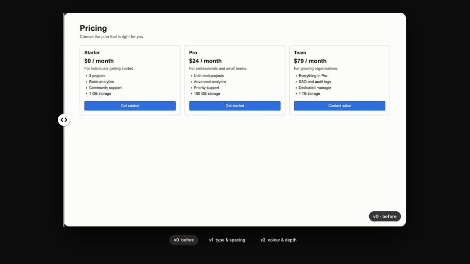

# Wipe

Wipe keeps every pass of a UI as a version, so you can compare any two and show the change. It captures the page, builds a slider page to compare versions, and renders a before/after clip from the same captures.



## Install

```bash
npx skills@latest add blakecyze/skills --skill wipe
```

For a local clone, replace `blakecyze/skills` with `.` from the repository root. Claude Code can use `/plugin marketplace add blakecyze/skills` followed by `/plugin install wipe@cyze`.

## Use

```text
$wipe snap before
$wipe show
$wipe clip
```

The skill accepts an optional verb, routes, and a note.

- `snap` saves the current UI as the next version. The first snap of a run fixes the viewport, theme, and routes, and later snaps reuse them. Web pages are captured from a URL; native apps are saved from a screenshot you take with the simulator's own tool.
- `show` writes a compare page for two versions and opens it. It offers wipe, side by side, onion skin, and diff modes.
- `clip` renders `clip.mp4` and `clip.gif` that wipe through the versions. A receipt card can add measured numbers from the first and last versions.

`embed` writes a standalone before/after snippet for docs, and `base` rebuilds an older git ref in a temporary worktree, which recovers a "before" when the edits have already started. Versions live in `.wipe/` at the project root, kept out of git through `.git/info/exclude`.

The agent snaps a baseline before the first edit, then once per pass that changes what you see. It writes each note in your terms, such as "tightened card spacing", not as a diff summary. [wipe.py](skills/wipe/scripts/wipe.py) does the work, and `python3 wipe.py --help` lists every command.

Litmus tests that the build works. Vitrine judges how work is shown. Wipe shows what changed between passes.

## Requirements

- Python 3.9 or later. `show` and `embed` need nothing else.
- Chrome, Chromium, Edge, or Brave for web capture, or Playwright. Playwright adds full-page capture (`--full`) and `--measure`.
- Pillow and ffmpeg, for `clip` only. Without ffmpeg, `clip` builds the compare page instead and exits with code 3. Without Pillow it exits with code 3.

A missing optional dependency exits with code 3 and an install line for a temporary virtual environment.

## Limits

Headless Chrome captures the viewport only. Full-page capture needs Playwright, and without it Wipe captures the viewport and warns.

Versions compare fairly only under the same conditions. Wipe checks viewport, theme, and routes, and warns when they differ. It cannot check data, sign-in state, or scroll position, so keep those the same yourself.

A receipt needs the first and last versions both measured on the same host. Numbers from localhost or a local file are labelled as such on the card. The card says `production build` only when both versions were snapped with `--production`.

The diff mode highlights changed pixels and gives no percentage. Wipe is not visual regression testing: it sets no thresholds and passes or fails nothing. Litmus owns QA.

Validation scenarios live in `evals/evals.json`. They require judging actual agent work; static validation does not execute them. Unit tests run with `python3 -m unittest discover -s skills/wipe/tests -v` from the repository root.

MIT. See [LICENSE](LICENSE).
